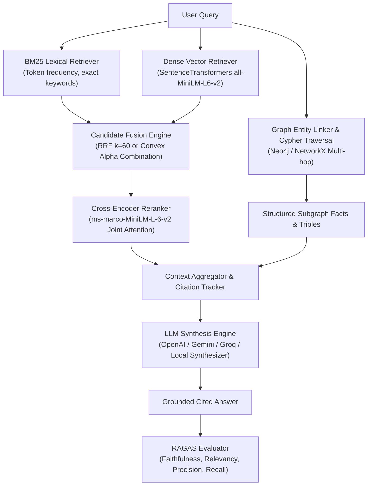

# ⚡ Advanced RAG: Hybrid Search, GraphRAG with Neo4j & RAGAS Evaluation

A comprehensive, production-grade Retrieval-Augmented Generation (RAG) platform implementing advanced retrieval, graph knowledge representation, and rigorous quantitative evaluation:

1. **Hybrid Search plus Reranking**: Sparse Lexical (BM25 Okapi) + Dense Vector Embeddings (`all-MiniLM-L6-v2`) + Reciprocal Rank Fusion (RRF) / Convex Linear Combination + Cross-Encoder Reranking (`cross-encoder/ms-marco-MiniLM-L-6-v2`).
2. **GraphRAG with Neo4j**: Knowledge Graph extraction (Entities, Relationships, Chunks), Entity Linking, Multi-Hop Cypher Graph Traversals, and Hybrid Graph+Vector Context Synthesis (with resilient zero-setup in-memory fallback).
3. **Evaluation with RAGAS**: Quantitative evaluation of Faithfulness, Answer Relevancy, Context Precision, and Context Recall across Baseline Vector RAG, Hybrid+Rerank RAG, and GraphRAG.
4. **Interactive Streamlit Web Studio**: Full-featured graphical playground with candidate search visualizers, interactive 2D PyVis graph explorer, and live RAGAS radar benchmark dashboards.

---

## 🏛️ System Architecture



---

## 📂 Project Structure

```
d:/Data_Scientist_MNC_3/
├── config/
│   ├── __init__.py
│   └── settings.py               # Central config (Neo4j, LLMs, Embeddings, Reranker, Ragas)
├── data/
│   ├── sample_corpus/            # Enterprise knowledge base (Cloud, Neo4j, Advanced RAG)
│   │   ├── 01_advanced_rag_architectures.txt
│   │   ├── 02_graph_rag_and_neo4j.txt
│   │   └── 03_distributed_systems_and_cloud.txt
│   ├── evaluation_dataset.json   # Ground-truth evaluation dataset with contexts
│   └── benchmark_results.json    # Serialized comparative benchmark results
├── src/
│   ├── __init__.py
│   ├── document_loader.py        # Semantic chunker & metadata enricher
│   ├── hybrid_rag/               # Module 1: Hybrid Search + Reranking
│   │   ├── __init__.py
│   │   ├── bm25_retriever.py     # BM25Okapi sparse lexical search
│   │   ├── dense_retriever.py    # Dense vector cosine similarity
│   │   ├── hybrid_fusion.py      # Reciprocal Rank Fusion (RRF) & Weighted Linear Fusion
│   │   ├── reranker.py           # Cross-Encoder passage reranker
│   │   └── hybrid_pipeline.py    # Complete Hybrid RAG orchestration pipeline
│   ├── graph_rag/                # Module 2: GraphRAG with Neo4j
│   │   ├── __init__.py
│   │   ├── neo4j_client.py       # Dual-mode Neo4j driver + NetworkX fallback
│   │   ├── entity_extractor.py   # Named entity & relationship triple extractor
│   │   ├── graph_builder.py      # Ingests documents into Knowledge Graph
│   │   ├── graph_retriever.py    # Entity linking & multi-hop Cypher traversal
│   │   └── graph_pipeline.py     # Graph + Vector hybrid synthesizer
│   ├── evaluation/               # Module 3: Evaluate with RAGAS
│   │   ├── __init__.py
│   │   ├── ragas_evaluator.py    # Faithfulness, Relevance, Precision, Recall
│   │   ├── benchmark_runner.py   # 3-way comparative benchmark runner
│   │   └── reporter.py           # Markdown tables, metrics, radar charts
│   └── generator/                # Grounded LLM generation & citations
│       ├── __init__.py
│       └── llm_factory.py        # Unified OpenAI/Gemini/Groq/Local synthesizer
├── app.py                        # Streamlit Interactive Web Application
├── run_hybrid_rag.py             # CLI runner for Module 1
├── run_graph_rag.py              # CLI runner for Module 2
├── run_evaluation.py             # CLI runner for Module 3
├── requirements.txt              # Project dependencies
├── .env.example                  # Environment template
├── .env                          # Local configuration
└── README.md                     # Comprehensive documentation
```

---

## 🚀 Quickstart Guide

### 1. Installation
Ensure Python 3.10+ is installed:
```bash
pip install -r requirements.txt
```

### 2. Configuration (`.env`)
The system works out-of-the-box with zero mandatory setup.
- If Neo4j is running locally (`bolt://localhost:7687`) or via Neo4j AuraDB, provide credentials in `.env`. If not, the system automatically uses the zero-error **In-Memory Graph Engine**.
- If OpenAI / Gemini / Groq API keys are provided in `.env`, they will be automatically used. If not, the built-in **High-Fidelity Grounded Synthesizer** runs offline with zero cost.

```env
EMBEDDING_MODEL_NAME=all-MiniLM-L6-v2
RERANKER_MODEL_NAME=cross-encoder/ms-marco-MiniLM-L-6-v2

NEO4J_URI=bolt://localhost:7687
NEO4J_USERNAME=neo4j
NEO4J_PASSWORD=password123
USE_IN_MEMORY_GRAPH_FALLBACK=true
```

---

## 🖥️ Running the Components

### Step 1: Run Hybrid Search + Reranking CLI
Demonstrates BM25 lexical search, Dense vector search, RRF candidate fusion, and Cross-Encoder reranking:
```bash
python run_hybrid_rag.py
```

### Step 2: Run GraphRAG with Neo4j CLI
Demonstrates Knowledge Graph construction, entity linking, 1-hop and 2-hop graph traversals, and hybrid Graph+Vector synthesis:
```bash
python run_graph_rag.py
```

### Step 3: Run RAGAS Evaluation Benchmark CLI
Executes a standardized comparative evaluation across all 3 RAG architectures:
```bash
python run_evaluation.py
```

### Step 4: Launch Interactive Streamlit Web Application
```bash
streamlit run app.py
```
Open [http://localhost:8501](http://localhost:8501) in your browser to access:
- **🔍 Hybrid Search & Reranking Playground**: Adjust $\alpha$, compare BM25 vs Dense vs Fused candidates, and inspect rank shifts.
- **🕸️ GraphRAG & Knowledge Graph Visualizer**: Interactive 2D PyVis node-link graph, Cypher query viewer, and multi-hop reasoning.
- **📊 RAGAS Evaluation Hub**: Live benchmark runner, Plotly radar comparison charts, and sample drilldown inspector.
- **📂 Ingestion & Settings**: Upload custom documents and configure live Neo4j database connections.

---

## 📊 RAGAS Metric Definitions

| Metric | What it Measures | Formula / Computation |
| :--- | :--- | :--- |
| **Faithfulness** | Are generated claims grounded in the context? | $\frac{|\text{Supported Claims}|}{|\text{Total Claims}|}$ (penalizes hallucinations) |
| **Answer Relevancy** | Does the answer directly address the query? | Semantic cosine alignment between user question and generated answer |
| **Context Precision** | Do relevant passages rank at the very top? | Mean Average Precision (MAP) weighted by reciprocal rank of relevant chunks |
| **Context Recall** | Did retrieval capture all ground-truth facts? | $\frac{|\text{Retrieved Ground Truth Sentences}|}{|\text{Total Ground Truth Sentences}|}$ |

---

## 🛡️ Key Architectural Highlights
- **Reciprocal Rank Fusion (RRF)**: $RRF(d) = \sum_{m \in M} \frac{1}{k + r_m(d)}$ ($k=60$). Scale-invariant fusion that avoids raw score calibration issues between BM25 and Cosine similarity.
- **Cross-Encoder Reranking**: Full token-to-token cross-attention between query and passage, eliminating the single-vector bottleneck of bi-encoders.
- **Dual-Mode Neo4j Architecture**: Production Neo4j LPG driver with connection pooling + NetworkX in-memory graph fallback.
- **Source Citation Provenance**: Every generated claim maps directly back to chunk IDs and knowledge graph relations.
